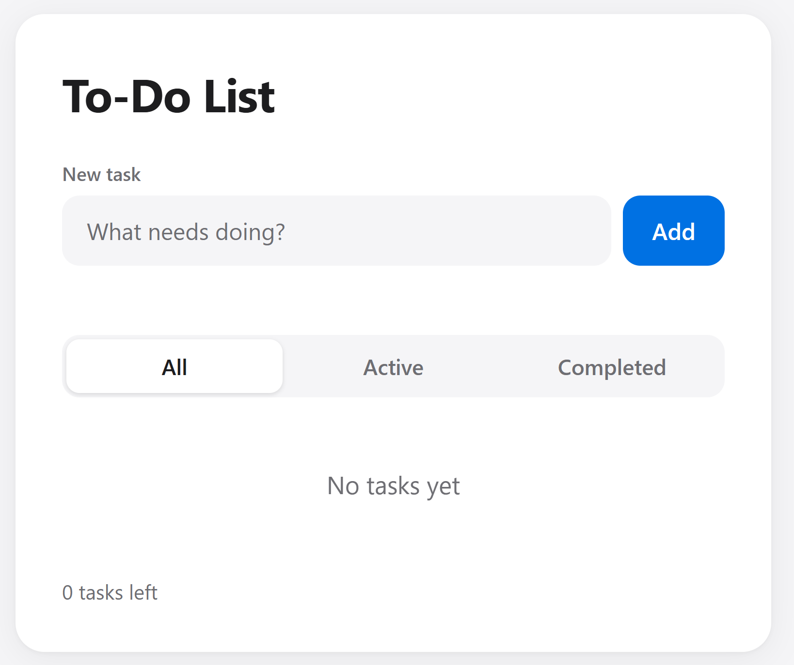

# To-Do App

A simple to-do list that runs in your browser. Your tasks are saved on your own device, so they are still there after you refresh the page or close the browser. There are no accounts, no server and no build step.

## Screenshot



## How to run

No install or build is needed.

1. Clone the repo:
   ```bash
   git clone https://github.com/the1andobijay/todo-app.git
   cd todo-app
   ```
2. Open `index.html` in your browser (double-click it, or drag it into a browser window).

Optionally, serve the folder locally instead:

```bash
python -m http.server 8000
```

Then visit http://localhost:8000.

## Features

- Add tasks with the **Add** button or by pressing **Enter**
- Mark tasks complete (completed tasks get a strikethrough) and delete them
- Filter by **All**, **Active** or **Completed**
- "N tasks left" counter
- Tasks persist across refreshes and browser restarts using `localStorage`
- Input checks: blank tasks are rejected and tasks are limited to 200 characters, with a friendly message
- Friendly empty-list messages
- Safe handling of storage problems: corrupt or missing saved data loads as an empty list, and you are warned if saving fails
- Task text is shown as plain text, so pasted markup can't run
- Keyboard-friendly, with visible focus outlines and accessible labels
- Apple-style design with dark mode

## Tech used

- HTML
- CSS
- Vanilla JavaScript (no frameworks or libraries)
- Browser `localStorage` for persistence
